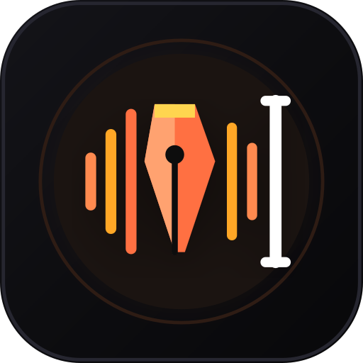

<p align="center">
  <a href="https://github.com">
    
  </a>
</p>

<h1 align="center">KothaPad (কথাপ্যাড)</h1>

<p align="center">
  <strong>The Ultimate Non-Stop Voice-Powered Notepad for Android</strong><br />
  <em>Continuous Dictation &bull; In-App Virtual Keyboard &bull; Bilingual Bengali & English &bull; Local-First &bull; 100% Private</em>
</p>

<p align="center">
  
  
  
  
  
</p>

---

## 🌟 Why KothaPad?

Traditional voice-to-text apps on Android suffer from frustrating limitations:
- ❌ **3-to-5 Second Cutoffs**: Standard Android `SpeechRecognizer` abruptly stops listening the moment you pause to think.
- ❌ **Loud Beeps**: Every restart triggers an annoying system sound that ruins your flow.
- ❌ **Lost Speech**: Unfinished thoughts are dropped when the recognition session cycles.
- ❌ **Screen Touch Kills Dictation**: Touching the screen to edit or position the cursor cancels speech recording.
- ❌ **Screen-Off Interruption**: Turn off your phone or switch apps, and recording stops.
- ❌ **Privacy Concerns**: Many dictation apps upload your audio to proprietary third-party servers.

**KothaPad solves all of this.** Engineered from the ground up for writers, journalists, students, thinkers, and coders, KothaPad pairs an **untrusted-silence supervisor engine** with a **concurrent in-app Compose keyboard**, smart punctuation pipeline, and zero-telemetry local-first storage.

---

## ✨ Features at a Glance

### 🎙️ 1. True Continuous Dictation Engine
* **Untrusted-Silence Supervisor**: Treats Android's silence timeouts as untrusted. Whenever the recognizer attempts to stop, the supervisor loop revives listening on the main thread in milliseconds.
* **Zero Lost Words Guarantee**: Speech chunks and partial transcription streams are continuously buffered and safely committed across every restart boundary.
* **Audio Stream Beep Muting**: Automatically suppresses `STREAM_SYSTEM` and `STREAM_NOTIFICATION` during continuous session restarts and restores volume cleanly—no jarring beeps!
* **Microphone Foreground Service**: Dictation runs via `DictationService` with persistent notification controls (Pause, Resume, Stop). Keep dictating even with your **screen locked** or while multitasking.
* **On-Device / 100% Offline Mode**: Harnesses `createOnDeviceSpeechRecognizer` (Android 13+ / API 33+) for blazing fast, completely offline voice transcription with zero data usage.
* **Smart Audio Routing**: Dynamically detects and adapts to Built-in Microphones, Bluetooth Headsets (SCO / Hands-Free mode), and 3.5mm / USB-C Wired Microphones.
* **5 Distinct Dictation Modes**:
  1. **Continuous Mode**: Non-stop dictation for long-form essays, lectures, and stream-of-consciousness journaling.
  2. **Toggle Mode**: Tap once to speak, tap again to finish.
  3. **Push-to-Talk (PTT)**: Press and hold to dictate; release to instantly commit.
  4. **Single-Shot**: One sentence at a time for quick notes.
  5. **Timed Dictation**: Set a custom countdown timer (1 to 60 minutes) for focused dictation sprints.

---

### ⌨️ 2. Concurrent In-App Virtual Keyboard
* **Type & Talk Simultaneously**: Unlike the system IME, KothaPad's built-in Jetpack Compose keyboard never steals audio focus or interrupts active speech recognition. Fix typos and add notes with your fingers *while still speaking*!
* **Multiple Built-in Layouts**:
  * 🔤 **English QWERTY**
  * 🇧🇩 **Bangla (বাংলা)**: Custom Bengali layout with complete vowel signs (কার), conjuncts, and characters.
  * 🔢 **Bengali & Western Numerals**: Instant toggle between `১ ২ ৩ ৪` and `1 2 3 4`.
  * 🔣 **Symbols & Punctuation**: Quick access to symbols, quotes, brackets, and math notation.
* **Precision Navigation**: Dedicated **◀ Left** and **Right ▶** cursor navigation buttons, space, backspace, and newline keys right on the keyboard bar.
* **System IME Compatibility**: One tap on the toolbar switches seamlessly between the in-app keyboard and your default Android keyboard (Gboard, Ridmik, SwiftKey).

---

### ⚡ 3. Intelligent Text Pipeline & Spoken Commands
KothaPad processes incoming voice streams through an automated three-stage text formatting pipeline:

1. **Spoken Punctuation & Voice Commands**:
   * **English**: Say *"full stop"* (`.`), *"comma"* (`,`), *"question mark"* (`?`), *"exclamation mark"* (`!`), *"new line"* (`\n`), *"new paragraph"*.
   * **Bangla (বাংলা)**: Say *"দাঁড়ি"* (`।`), *"কমা"* (`,`), *"প্রশ্নবোধক চিহ্ন"* (`?`), *"নতুন লাইন"*, *"নতুন প্যারা"*.
   * **Voice Actions**: Say *"delete last word"*, *"undo"*, or *"clear all"*.
2. **Spacing Sanitization**: Automatically normalizes punctuation spacing (removes awkward whitespace before commas and periods, ensures clean single spacing).
3. **Auto-Capitalization**: Automatically capitalizes the first word following sentence terminators (`.`, `?`, `!`, newline).

---

### 🏷️ 4. Dynamic One-Tap Text Stamps & Templates
* **Dynamic Macro Stamps**: Insert live metadata with a single tap from the scrollable stamp bar:
  * `{date}` &rarr; Current date (e.g. `14 Oct 2026`)
  * `{time}` &rarr; Current time (e.g. `12:03 PM`)
  * `{datetime}` &rarr; Complete ISO / formatted timestamp
  * `{cursor}` &rarr; Automatically places cursor inside boilerplate text
* **Custom Stamp Manager**: Create, rename, edit token strings, reorder, or delete stamps.
* **Pre-Built Note Templates**: Instantly jumpstart writing with templates for:
  * 📋 *Meeting Minutes*
  * 📓 *Daily Reflection / Journal*
  * 💡 *Quick Thought & Idea Capture*
  * 🎙️ *Audio & Interview Transcription Log*
  * ✅ *Action Item & Task Checklist*

---

### 📝 5. Distraction-Free Power Editor
* **Live Writing Metrics**: Real-time counter for **Word Count**, **Character Count**, **Estimated Reading Time**, and **Speaking Session Duration**.
* **Full-Fidelity History**: Multi-step **Undo** and **Redo** stack.
* **AMOLED Dark Aesthetic**: Eye-friendly pitch-black background with warm ember/saffron accents (`#FF7043`) designed for battery savings on OLED screens.
* **Bundled Offline Typography**: Includes premium Google Fonts built into the APK:
  * **Inter**: Ultra-crisp modern sans-serif.
  * **Noto Sans Bengali**: Pixel-perfect rendering for complex Bengali ligatures.
  * **JetBrains Mono**: High-legibility monospaced font for code snippets or typewriter aesthetics.
* **Reading & Focus Controls**:
  * Fullscreen Zen writing mode with collapsible bars.
  * Adjustable font sizing and line spacing.
  * Customizable highlight colors for critical notes.
  * "Keep Screen Awake" toggle to prevent display sleep during long dictation sessions.

---

### 📁 6. Advanced Notes Organization & Batch Tools
* **Folder Organization**: Categorize notes into custom folders (*General*, *Work*, *Ideas*, *Personal*, *Drafts*).
* **Multi-Tagging**: Tag notes with `#tags` (e.g., `#urgent`, `#meeting`, `#article`) for instantaneous discovery.
* **Pinning**: Pin critical notes to the top of your list.
* **Instant Full-Text Search**: Filter across titles, note bodies, and tags as you type.
* **Trash & Archive**:
  * Archive finished notes to keep your workspace decluttered.
  * Safe Recycle Bin with instant restore or permanent purge.
* **Batch Operations**: Multi-select notes to **Move Folders**, **Bulk Archive**, **Bulk Delete**, or **Merge Multiple Notes** into a single cohesive document.

---

### 🛡️ 7. 100% Privacy & Local-First Resilience
* **Zero Telemetry**: No third-party analytics, no tracking SDKs, no ad networks, no login or account creation required.
* **Debounced Auto-Save (500ms)**: Every keystroke and voice result is auto-saved to Room SQLite database in the background.
* **Lifecycle Crash Protection**: Flushes unsaved buffers on Android lifecycle triggers (`onPause`, `onStop`).
* **Complete ZIP Backup & Restore (`.kothapad` / `.zip`)**:
  * Full JSON export containing all notes, custom stamps, spoken commands, and settings in a single portable zip archive.
  * Seamless restore with deduplication handling (Merge, Skip, or Overwrite).
  * Direct plain text and Markdown sharing to any other app.

---

## 📱 Screenshots & Visual Design

| App Icon | Dictation & In-App Keyboard | Notes Manager & Folders |
|:---:|:---:|:---:|
|  | Continuous speech with concurrent Bengali & English typing | Folder management, multi-tag filtering & batch operations |

---

## 📥 Download & Installation

Get the latest pre-compiled APK directly from the repository or GitHub Releases:

1. Download **[`KothaPad.apk`](./KothaPad.apk)** from the root folder or download it from the [Releases](https://github.com) section.
2. Open the `.apk` on your Android device (ensure *"Install from unknown sources"* is enabled in your browser/file manager).
3. Grant **Microphone** and **Notification** permissions when prompted.
4. *(Optional for Offline Bengali/English)*: In your Android System Settings &rarr; *Google Voice Typing / Speech Services by Google*, download the **Offline Speech Recognition Packs** for **English** and **বাংলা (বাংলাদেশ / ভারত)** for instant offline dictation.

---

## 🏗️ Architecture & Tech Stack

KothaPad is crafted following modern Android development best practices and Clean Architecture:

* **Language**: 100% Kotlin
* **UI Toolkit**: Jetpack Compose with Material 3 & custom drawing
* **Architecture**: MVVM (Model-View-ViewModel) + Single-Direction Data Flow (StateFlow / SharedFlow)
* **Local Persistence**: Room SQLite Database (DAO architecture)
* **Preferences**: Jetpack DataStore (typed preferences)
* **Background Processing**: Android Foreground Service with WakeLocks and ongoing notification channel
* **Audio Management**: Android `AudioManager` with audio ducking and `AudioRouting` APIs
* **Speech Integration**: Android `SpeechRecognizer` with supervisor loop and API 33+ `createOnDeviceSpeechRecognizer`
* **Adaptive Icons**: Android 13+ Themed Monochrome & Vector Adaptive Icon

---

## 🛠️ Building from Source

### Prerequisites
* Android Studio Ladybug | Hedgehog or newer
* JDK 17 or JDK 21
* Android SDK 35 (compileSdk 35, minSdk 26)

### Build Commands
```bash
# Clone the repository
git clone https://github.com/your-username/KothaPad.git
cd KothaPad

# Build the Debug APK (Gradle automatically restores debug.keystore and .env if needed)
./gradlew assembleDebug

# Run unit tests and Robolectric test suite
./gradlew :app:testDebugUnitTest
```

---

## 🤝 Contributing

Contributions, feedback, and feature requests are welcome!
1. Fork the Project
2. Create your Feature Branch (`git checkout -b feature/AmazingFeature`)
3. Commit your Changes (`git commit -m 'Add some AmazingFeature'`)
4. Push to the Branch (`git push origin feature/AmazingFeature`)
5. Open a Pull Request

---

## 📄 License

Distributed under the **MIT License**. See `LICENSE` for more information.

<p align="center">
  Crafted with ❤️ for writers, thinkers, and speakers worldwide.
</p>
